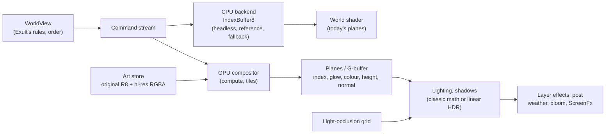

# The renderer: audit and the way to hi-res, true colour and shaders

Audit of 2026-10-13, revised the same day after an outside review (section 9). The requirement: one renderer that shows the original 256-colour art by Exult's rules (palettes and their blending, colour cycling, XFORM.TBL translucency), shows hi-res true-colour art, and has room for shaders for light, shadow and spell effects. This note says what the renderer is today, where it stops short, and the path recommended. Nothing here changes Exult's rules for what shows and when; it changes how the picture is made. The milestones are R0-R8 (the M-numbers belong to [SERPENT_ISLE.md](SERPENT_ISLE.md)).

## 1. What it is today

- **Rules and order (CPU):** `WorldView.PaintView` walks the chunks as Exult's `Game_render::paint_map` does: the flats, the flat RLE objects, the other objects in dependency order along the diagonals, the dungeon blackness, then missiles, homing missiles and sprites. Since R1 (2026-10-13) it records what it decides as the command stream of 5.1 (`PaintStream`), which the backend replays once the frame is recorded: `IndexBuffer8` on the CPU (the default), or since R2 the compute compositor of 5.2 (`GpuCompositor`, `art renderer gpu`), which writes the same planes as textures.
- **Pixels (CPU):** `IndexBuffer8` (Exult's `Image_buffer8`) rasterises every frame scan by scan into planes: indices (R8), glow (R8: six bits of glow plus the roof and pane marks), panes (ushort, CPU only), mix (RG8, hi-res art) and colour (RGBA8, hi-res true colour). The whole view is painted and uploaded again every frame (`WorldView.Upload`).
- **Colour and light (GPU):** one `canvas_item` shader (`WorldView.ShaderCode`, ~270 lines): each index looked up in two palette rows, ambient and lit (`WorldPalette`, cycling included); mixed and true-colour pixels turned through the palettes (`PaletteSlopes`); an optional 4-tap sharp fill; a loop over up to 64 lights in a uniform array (pools, the light spell, four window kinds); cloud shadows and mist from fbm noise.
- **Hi-res:** `HiresArt` hands over frames at one integer scale (packs are 4x; without a pack, the original blown up). Above 2.5 million buffer pixels (below zoom ~3 at 1280x800) the original art is painted instead.
- **Elsewhere:** gumps, faces, pictures and the cursor are RGBA textures in the fixed day palette (`ShapeCache`); weather is a world-space `Node2D` lit by one brightness value (`WeatherView`); fades and the red pulse are screen-space (`ScreenFx`). These are the project's only two shaders. There is no SubViewport, `Light2D`, HDR or compute; `project.godot` sets no rendering method and no `use_hdr_2d`.
- **Measured** (PROGRESS.md, "Hi-res art (current)"), windowed at 2880x1800, zoom 4, the 4x art (a 1288x808 buffer): painting about 3 ms (1 ms at 1x), the upload 0.5-0.9 ms, the GPU 0.1 ms. Headless at 1x (a 322x322 buffer, the `quick` save in Trinsic) 2.6 ms. R0's matrix (PROGRESS.md, "Renderer baseline (current)", 2026-10-13, a Ryzen 5 7535U laptop with its integrated Radeon) has zoom 2-8 at 1x and 4x: about 2 ms a frame whatever the buffer, plus some 6 ns a buffer pixel to paint and 2.8 ns to upload.

## 2. What it does well (keep)

- **Exult-exact:** paint order, XFORM translucency, cycling, palettes and blends, invisible actors, outlines and the dungeon blackness are index for index Exult's. `art check` proves the 4x path paints the same pixels as the 1x path.
- **Rules and pixels are apart:** `WorldView` decides what is painted, where and in which order; `IndexBuffer8` only rasterises. Because of that seam a new backend needs no change to Exult's logic.
- **Headless:** it runs headless, and the agent console's play-tests depend on that.
- **Cheap** at the default zoom.

## 3. Where it stops short

| Requirement | Today | The limit |
|---|---|---|
| High resolution | Texel density is the art's integer scale (4x), painted on the CPU | At 2880x1800 and zoom 4 a world pixel covers 9 screen pixels, so the 4x art is magnified 2.25x; below zoom 3 the original returns; 8x art would cost four times the 4x paint. The cost grows with buffer pixels: about 3 ns a pixel to paint, 4 bytes a pixel to upload (8 with true colour), every frame the view moves. Painting at native resolution (9x, about 5.3 million pixels) would be roughly 15 ms and 42 MB a frame by those numbers: an extrapolation, to be measured in R2, not a measurement. |
| True colour | `ArtLook.TrueColour`: off by default (`art truecolour on`) | Every pixel must keep a palette index as its anchor. The colour plane's alpha only says "own colour or not", so there is no opacity. Packs must be exactly 4x the original frame. Silhouettes are binary (a painting's soft alpha is cut at 128). Cycling and see-through pixels keep the original index, blown up, so water, lava, flames and glass stay blocky. |
| Original art | Exact | Nothing missing. Any new path has to keep this. |
| Light | One shader pass, 64 lights | Nothing stops light but roofs, which hide a light whole on the CPU, so pools shine through walls. `WindowLights` (341 lines) and the roof and pane marks stand in for occlusion. No per-pixel height or normal, so no shadows and no directional light. Colours are mixed gamma-encoded, the output is 8-bit LDR, glow is a multiplier, so there is no bloom. |
| Spell effects | Sprites in the index buffer; the light spell, windows, clouds and mist as branches of the world shader | No additive blending, soft alpha, distortion or particles. A new effect means editing the one shader. Weather is lit by one brightness value (rain doesn't catch torchlight). No post chain. |
| One art path | World in 8-bit; gumps as RGBA in the day palette | Gumps don't cycle or take palettes, and their XFORM is approximated (PROGRESS.md, "Not done"). |

**Why the CPU buffer was chosen** (AUDIT.md "Checked and fine", ENGINEERING.md 5.1): XFORM recolours the pixel underneath through a table, which ordinary GPU blending can't do, and Godot's canvas screen texture is copied once per frame, not once per sprite, so ENGINEERING.md's plan (translucent shapes reading a screen-space R8 copy) would not be exact either. That holds for canvas drawing. It does not hold for a compute shader, which composites in any order by any rule.

## 4. Two contracts, one scene

The renderer serves two guarantees that must not be confused. Both consume the same command stream (section 5.1); they differ in what a pixel is.

| | Classic (exact) | Modern (enhanced) |
|---|---|---|
| A pixel is | a palette index (plus the glow and marks) | RGB with alpha; an index only where the art keeps one |
| Palettes, blends, fades | exact lookups in Exult's palettes, gamma-space as today | the same palettes graded onto true colour through LUTs (5.5) |
| Cycling | exact (`WorldPalette`'s rotation) | a cycle range and phase per pixel at the art's own resolution (5.4); replacement animations where painted |
| XFORM | the tables, on the index | on indices the tables; on true colour a LUT per table |
| Alpha | binary coverage, as Exult | straight alpha |
| Lights (the remake's own: pools, spell, windows) | today's shader math | linear-light HDR, occlusion, shadows |
| Proof | the planes bit-exact to `IndexBuffer8` | shots the user approves, plus difference images against classic |

Classic is what the game shows today and stays the default until the user has approved the modern look; the CPU backend is classic by construction and stays permanently (headless, the reference, the fallback).

## 5. The design: Exult decides, a compositor paints

The diagram is the data flow, not a list of GPU passes.

### 5.1 The command stream

`PaintView` records ordered commands instead of painting; a backend replays them. A command holds the frame (file, shape, frame, scale), its hotspot in buffer pixels, the op, the glow and haze bytes, the marks, the window slot, the xform table, the outline colour, and the object (for its lift, its TFA box and, later, its material class). Everything `DrawObject` does besides painting stays in the recording pass on the CPU: `Animators.Painted` (the animated frame), `PaintStamp` (what a click picks), the barks, `Windows.SlotOf` (window slots). Nothing else in the game reads the pixels.

The ops are `IndexBuffer8`'s methods, which are the executable specification; the table says what each does to each plane at one pixel. "Replace" means the op's own value, independent of what was there; "transform" means a function of what was there.

| Op | Exult | Index | Glow | Mix, colour | Panes |
|---|---|---|---|---|---|
| `Copy8` (the flats) | `copy8` | replace | replace | replace, or clear | - |
| `Fill8` (blackness) | `fill8` | replace | clear | clear | - |
| `PaintRle` (opaque frames, raw tiles) | `paint_rle` | replace | replace | replace, or clear | - |
| `PaintRleTranslucent`, pixel < 0xEE | `paint_rle_translucent` | replace | replace (glow) | replace, or clear | - |
| `PaintRleTranslucent`, pixel 0xEE-0xFE | " | table[under] | replace (haze) | mix's second index through the table; colour by `TurnColour` | written when haze marks panes |
| `PaintRleThroughPanes` | (remake) | on marked pane pixels of listed windows only: the pane's table on the frame pixel, or the frame's table on under | glow bits replaced, marks kept | as above | kept |
| `PaintRleTransformed` | `paint_rle_transformed` | xform[under] | clear | mix through xform; colour by `TurnColour` | - |
| `PaintRleOutline`, `PaintRleSolid` | `paint_rle_outline` | replace | clear | clear | - |

So at one pixel an op is either **replace-all** (`Copy8`, `Fill8`, `PaintRle`, the outline ops, and a translucent frame's pixels below 0xEE) or a **transform** (a translucent frame's see-through pixels, `PaintRleThroughPanes`, `PaintRleTransformed`). Which one a translucent frame's pixel is depends on the frame's texel, so it is decided per pixel, after the fetch. The panes plane is read only under a pane mark, and every replace-all op clears the mark, so a replace-all op determines every plane a later op can read.

### 5.2 The compositor: an ordered state machine

The compute backend bins the stream into 16x16 screen tiles (a command enters every tile its frame's rectangle touches) and resolves each pixel by the table above.

- **The reference resolve** walks the tile's list from the bottom up and applies every op in order, exactly as `IndexBuffer8` does, with the planes as per-thread state. It is the first implementation and the one parity is proven against.
- **The skipping resolve**, only after the reference passes the suite: walk from the top down to the topmost replace-all op at this pixel, take its state, then apply the transforms above it in order. Equivalent by the last paragraph of 5.1 (the state after a replace-all op is that op's alone; every pixel has one, since the flats cover the view). Typical depth to the first opaque texel is one to three fetches.
- Original texels resolve exactly as the CPU does (the tables on indices). True-colour texels blend by alpha, and a transform on them goes through that table's colour LUT (5.5), as `XformTables.TurnColour` does today for anchored pixels.
- **Output** at the window's resolution. In R3 the output is today's planes (index, glow, mix, colour), so the world shader stays as it is. From R6 it is a G-buffer: albedo, index and cycle flag, glow and marks, height and normal (5.6), taken from the pixel's topmost replace-all op; the transforms above only recolour (lighting comes after compositing, as it does today: a pane and what shows through it get the same light).
- Multiple translucent layers over one pixel are handled in order like any other op; a difference image on stacked glass and ghosts is part of the suite (section 7).

### 5.3 Godot integration

- **The device:** the global one, `RenderingServer.GetRenderingDevice()`. It is null headless and under the Compatibility renderer, which selects the CPU backend. A local device (`CreateLocalRenderingDevice`) cannot share textures with the canvas, so it is not used.
- **The frame:** `_Process` builds the command stream and the tile lists on the CPU (double-buffered). `RenderingServer.CallOnRenderThread` runs the upload (`BufferUpdate` of the stream and the tile lists, `TextureUpdate` of new atlas pages) and the dispatch (`ComputeListBegin`, `ComputeListBind*`, `ComputeListDispatch`, `ComputeListEnd`) on the render thread, before Godot draws the frame. Barriers and layout transitions are the engine's (automatic since 4.3). Never `Submit`/`Sync` on the global device.
- **Presentation:** the output images are RD textures wrapped in `Texture2Drd`, drawn by `WorldView.DrawTextureRect` and bound to the world shader's samplers (`glow_tex`, `mix_tex`, `colour_tex`) exactly as the `ImageTexture`s are today. No readback.
- **Resize and zoom:** the outputs are made again when the viewport's size changes; nothing else persists across frames but the atlas (5.4).
- **Failure:** a compute backend that fails to build its shader or textures logs it and falls back to the CPU backend for the session.
- **Selection:** `art renderer cpu|gpu|auto` in the console, kept in `saves/settings.cfg` (`Core/Settings`); `auto` is gpu where a device exists. Switching at run time is a change of backend for the next frame, as the art pack switch is today.
- **Godot version:** every name above is in Godot 4.7's C# assembly (checked 2026-10-13: `Texture2Drd`, `CallOnRenderThread`, `GetRenderingDevice`, `ComputeListBegin`, `UseHdr2D`); they date from 4.2 (`Texture2DRD`, `call_on_render_thread`) and 4.3 (automatic barriers), so the 4.6.1 on this machine has them too.

### 5.4 The art store and the pack specification

As built in R4 (2026-10-13); the paragraphs say where the build stops short of the first draft.

- **Logical and visual bounds.** A frame's logical bounds are the original's (hotspot, `XLeft`/`YAbove`/`XRight`/`YBelow`, times the frame's scale): the game's, for ordering, picking, barks, hit tests, weapon spots. Its visual bounds are what its scans cover (`ShapeFrame.VisualBounds`), relative to the same hotspot, at the frame's own scale; pack version 3 lets them overhang the logical bounds (a halo, a painted shadow: `pack.py --margin`). Nothing is resized, centred or cropped to fit the original rectangle; a painting of the wrong size is reported and left out (`pack.py`), as `sets.py --check` lists them.
- **A scale per frame** (`ShapeFrame.Scale16`, the scale times 16, so a painting fitted by height can have any): a pack may mix 2x, 4x and 8x frames, and the painted faces come at whatever their height gives. In the world a frame at another scale than the buffer's is resampled to it by nearest pixel on the CPU (`ShapeFrame.Rescaled`), so placement is exact (the placement pack proves it: the avatar and Iolo at 2x and 8x paint pixel for pixel as the original at 4x); the first draft's sampling at each frame's own density stays for the modern path, where the compositor would fetch by sample rather than integer texel.
- **Identity.** Entries stay (file, shape, frame); a reflected frame (bit 5) is made from its base frame as before (`HiresArt`), so the two never drift apart. An animated shape's frames (TFA's flag, more than one frame) and a sprite's are packed into the GPU store together when one is first painted (`GpuCompositor.Siblings`), so an animation never waits on a frame going up.
- **Original frames** are the same frames, their alpha plane absent: coverage 255, exactly as before.
- **Hi-res frames** carry straight alpha (flag 8: a byte a pixel, kept soft; the model packs' bicubic silhouette is now soft rather than cut at a half) and their own colours (RGBA, A 255 where a pixel shows its colour, 0 for a kept pixel). The kept-index plane of the first draft is the index plane itself: a see-through pixel keeps its table index, and a cycling pixel is quantised by `pack.py` to the entry of its own range nearest the painting's colour, texel by texel, so the sea's glints and the fires cycle at the painting's resolution in Exult's rotation (`WorldPalette`'s, unchanged; `cycling_check.py` counts the blocks that vary). Optional planes per frame, carried and unused until R6 and R7: normal (flag 16, two bytes), height (32), emissive (64).
- **Classic and soft alpha.** Both backends count a pixel from 128 (`ShapeFrame.Covered`): the index, glow and mix planes see Exult's binary coverage, and the original art, having no alpha plane, goes through the painters' old code unchanged. With true colour on, every alpha blends into the colour plane over what is there (the pixel's own colour, else its index's day colour), the same integer math on the CPU (`IndexBuffer8.BlendColour`) and the GPU; a transform turns a pixel's own colour by `XformTables.TurnColour`'s fit, the GPU in the same float order (`precise`), so the colour plane is bit-exact between the backends too.
- **The store.** The GPU's art store stays one storage buffer of dense texels (a uint a texel: index, alpha, the mix bytes; a coloured frame two, the second its RGBA), fetched by integer texel in the compute shader: exact, and what the reference resolve needs. Rather than 4096² texture pages, it is split into a ring of eight pages (`ArtLook.StoreMb`, the console's `art store <MB>`, 256 MB here): a new frame goes into the current page, and when that is full the oldest page is freed and taken over, its frames packed again when next painted; a frame whose art fills every page in one prepare empties the store and tries once more, then the CPU paints it. Texture pages with mipmaps and the sharp rule at each frame's density belong with sampling, in the modern path.
- **Gumps and faces** take a pack frame at its own scale (`ShapeCache.HiresTexture`: the picture is the frame's visual bounds, reported at the original's size); a UI frame that overhangs its extents is not shifted (none does yet).

### 5.5 Colour

As built in R5 (2026-10-13).

- **Classic:** indices through the palette rows with cycling, XFORM through the tables, the glow and marks as today, in today's shader math. The pixels equal `IndexBuffer8`'s. Modern is the default since the user, shown the shots, found no discernible difference and took either look (2026-10-13); `art modern off` returns to classic.
- **Modern** (`ArtLook.Modern`, `art modern on|off`): a true-colour pixel takes the ambient and lit palettes through two 3D LUTs (`Rendering/ColourLut`, 32³, `art lut 64` for the fallback), each cell taking the nearest palette entry below the cycling ranges as its anchor and evaluating `PaletteSlopes`' fit there, so the LUT is today's true-colour rule made continuous and a soft pixel blended over the ground (R4) carries no anchor; a transform table applies through a LUT per table made the same way from `XformTables.TurnColour`, in the compositor (`lut_turn`, trilinear by hand on a storage buffer). Palette colours map to within interpolation error: measured, the ambient table strays at most 1 level on the palette's own colours (0.02 on average at 22:00, exact by day, the lit table exact), 32³ and 64³ alike, since a cell whose eight corners share an anchor interpolates an affine map exactly and only the cells between two anchors blend their maps; so the 64³ fallback stays unused. Original pixels stay exact, so the seam between a hi-res frame and an original pixel beside it is that one level. The palettes' tables are rebuilt when the palettes change (6 ms at 32³, 47 at 64³), the tables' once.
- **Colour space:** the palettes and their blends stay gamma-space (they are Exult's numbers; the LUTs map gamma colours). In modern mode the world shader converts the ambient and lit colours to linear light once they are known, mixes the remake's own lights (pools, spell, windows, glows), the cloud shade and the mist there, and converts the result back for the screen. `UseHdr2D` is not switched on: with it, Godot gives every 2D texture an sRGB view, which would decode the R8 index plane as colour; the linear math lives in the shader instead, and HDR waits for R7's bloom, which reads the compositor's RD textures with explicit formats. Classic keeps today's math.

### 5.6 Geometry and light occlusion

As built in R6 (2026-10-13), the paragraphs after the design saying how far.

Sprite boxes are not surfaces: a canopy is not a prism, a roof slopes, a wall has a doorway, an actor's silhouette has no normal. So height and normal per pixel are **metadata with a fallback chain**, never invented from the silhouette:

1. the pack's height and normal maps where an artist or a model painted them;
2. a per-shape proxy from data (`godot/data/<game>/patch`, the remake's own file, as `shape_additions.txt` is): `box` for the building class where TFA boxes match the art (walls, floors, roofs, doors), `ground` (every pixel at the object's lift, a flat normal) for everything else by default;
3. neutral: lit as today, by screen distance alone.

The box and ground proxies use Exult's own numbers (the lift and TFA size the game orders and blocks by), and only as a fallback. The inverse projection is the one `WorldView.WorldToTile` already uses for picks: a screen point at lift z is the world point `(x + 4z, y + 4z)` (Exult `Get_shape_location`).

**Light occlusion** is a grid of its own at tile × lift, not `ChunkBlocking`: movement blocking isn't light blocking (a window blocks walking and passes light; an open door passes both; a tree's trunk blocks light, its canopy half; a magic field emits). It is built from the same per-chunk object lists by a **light class per shape** (opaque, glass = TFA translucent, door by frame, none) and the object's box, kept up to date as objects move exactly as `ChunkBlocking` is, uploaded for the view's tiles as one texel per tile (the lifts as bits, a class per lift where needed). Roofs keep today's rule (`GameMap.CoverAbove`).

**As built (R6):**

- **The lift plane.** The G-buffer's height is a lift plane beside the index plane (`IndexBuffer8.Lift`, the compositor's `out_lift`), written by every replace-all op and by a see-through pixel (the glass is what shows), kept by a transform: the fallback chain's second step, from the command's object. Every object gets the ground proxy (its lift over its whole picture); a building-class piece gets the box proxy: Exult's projection draws a point 4 pixels up and left a lift, so a pixel on a piece's south face is as high as its row says, one on its east face as high as its column says, and one on its top is at the full height, which the smaller of the two gives on all three (`IndexBuffer8.LiftAt`; the compositor does the same per pixel). The pack's height maps (R4) are carried but not yet read into the plane, the first step of the chain. A pixel's world point is then `(x + 4z, y + 4z)` in the shader, as `WorldToTile` picks.
- **The grid** is `World/LightOcclusion`, `GameMap.LightBlocking`, a twin of `ChunkBlocking` updated at the same four places (an object inserted, removed, its shape changed; a door turning is a remove and an insert). The class comes from `godot/data/bg/patch/light_classes.txt` (sections `opaque`, `glass`, `none`; a mod's file layers over it) over a default rule: a translucent shape is glass; a solid building piece, a door, or any solid thing three lifts tall or more (mountains, trees, boulders) is opaque; the rest, furniture included, is none; actors never cast (they would flicker). Doors need no class of their own: Exult blocks by the door's footprint, which turns with its frame, so a closed door stops light in the doorway and an open one beside it. `WorldView.UploadOcclusion` writes the view's tiles and a margin of 16 (a pool's reach) as an RGBA8 texture each frame, a texel a tile, the 32 lifts as bits (about 4,000 columns, under a millisecond).
- **The march**, in the world shader for pools and the light spell (window light keeps its stand-in): from the pixel's world point at its lift to the light's centre at its lift (packed into the light's kind as `kind + 16 lift`), a step a tile, neither end's own tile tested, blocked where the grid's bit at the lift along the way is set; three rays, the outer two half a tile to either side of the light, so an edge softens. A roof-marked pixel takes no light from a light below it (no light crosses a floor). `art occlusion on|off` (`ArtLook.Occlusion`, on by default, kept in the settings).
- **Normals** stay for later: a wall's faces take light by distance as before, so a wall's visible south and east faces beside a light to its west go dark with it (their own tiles stand between them and the light), which is what a light behind a wall does, but a thin wall's top is lit from beside it, which a top isn't. No sun or moon direction yet: a look question for the user, asked with rendered options.

### 5.7 Lighting

- After compositing, per pixel, from the G-buffer: Exult's ambient palette (classic exact, modern through the LUT), then the lights from per-tile light lists (no 64 cap), each occluded by a short ray-march through the light-occlusion grid from the pixel's world point to the light, softened by the light's radius. Pools, the light spell, windows, clouds and mist are ported as they look now (the user's picks); whether `WindowLights`' stand-ins can then go is decided from shots.
- A sun or moon direction for daytime shadows is a look question for the user, asked with rendered options, and off until then. Not every object casts: only the light classes above do.
- Bloom from the glow and HDR in modern mode.

### 5.8 Effects at three stages

- **World-space**, in the command stream: sprites, missiles, magic glows, particles and distortion anchored to tiles, so roofs and walls hide them as today.
- **Layer**, between the world and the gumps: weather (lit by the lights from the G-buffer), mist, cloud shadows.
- **Screen**: `ScreenFx` (fades, the red pulse) stays last.

**As built (R7, 2026-10-13):** the world-space stage is the command stream as it stands (sprites, missiles and homing missiles with their glow bytes and lifts; particles and distortion have no effect in the game asking for them yet, so none were built). The layer stage: `WeatherView` draws its rain and snow through a shader of its own that brightens each drop in a pool's or the light spell's light where it falls, in the light's colour (`WeatherLook.LightCatch`; the lights are `SceneLighting`'s, unoccluded, since rain is in the air), over the time-of-day darkening it had; cloud shadows and mist stay in the world shader. Bloom (5.7) is a pass between the world and the weather: a `BackBufferCopy` of the screen after the world, then a child item of `WorldView` drawing the world's rectangle additively with sixteen taps on two rings, each the screen's colour there times the glow plane's six bits there, so magic, blasts and lit things spill their light (`ArtLook.Bloom` and `BloomRadius`, `art bloom <strength> [radius]`, 0.35 at 10 world pixels; modern mode only). The screen stage is `ScreenFx` as before. HDR stays off (5.5): the bloom adds in LDR and clamps.

### 5.9 Gumps share the art and the palette, not the compositor

Gumps already decode through `ShapeCache`; the hi-res store serves them the same frames. Their missing palette behaviour (cycling, palettes under fades, XFORM on what is under a see-through item) is a small canvas shader on `GumpView` reading `WorldPalette`'s texture, independent of the world compositor and possible before it. The world's ordering, occlusion and lighting have nothing to do with a container's grid.

**As built (R8, 2026-10-13):** every gump texture (`ShapeCache.Get`, `GetGump`, `GetPaperdoll`, `GetSprite`) is a `CanvasTexture` whose normal map is the frame's index plane (`ShapeCache.IndexPlane`, RG8: the palette index, and a marker: an original pixel, a see-through pixel of a translucent shape, a hi-res pixel). `GumpView`'s shader (`GumpCode`) shows an original pixel by the palette texture's row 0 (the ambient palette with its cycling, under `ArtLook.GumpPalette`: Exult's one palette, so gumps are dark at night and follow the override palettes; row 1, the day palette, with `art gumps off`), a see-through pixel by what the screen shows under it turned through the pixel's table (modern colour's table for it, `ColourLut.XformTexture`, else the blend colour as before), a hi-res pixel by its own colour through modern colour's ambient table and its kept cycling pixels by the palette; fonts and painted faces carry no index plane and are plain colours. The screen under a see-through item must hold the container it lies in, and Godot copies the screen once per canvas item, so each open gump is drawn as two child items of `GumpView` (`GumpPass`), the opaque art and items first, the see-through items second, with the drag, book, picture and sign in a last pass over all; a see-through item under an opaque one in the same gump is thus drawn over it, the one approximation left.

### Why compute, what it costs, what else was weighed

- Exact XFORM and any destination-dependent op need read-after-write in paint order; a G-buffer needs several outputs from one draw, a canvas shader has one; thousands of overlapping frames at full resolution are cheaper binned than overdrawn. All three are hypotheses until R2 measures them.
- Costs: `RenderingDevice` code (Forward+ and Mobile only), no GPU headless (the CPU backend stays the reference), atlas streaming, per-frame stream and tile-list upload (a few thousand commands, well under a megabyte), divergent per-pixel loops in high-overlap scenes.
- **Godot canvas sprites with SubViewport G-buffers:** simpler, but XFORM becomes alpha blending (an approximation of the original's glass, ghosts and fields) and every G-buffer plane draws the whole list again.
- **A faster CPU** (parallel bands, skipping unchanged regions): stays exact, but the upload grows with output resolution and skipping doesn't help while the view scrolls, which is whenever the avatar walks. It is the comparison baseline in R2, with bands implemented if the measurement calls for it.

## 6. Milestones

Every step sits behind `art renderer`; the CPU backend stays the default until the user has approved shots of each new look.

- **R0, baseline** (done 2026-10-13 but for one column): a timing matrix (zoom 2-8 × 1x and 4x × 1280x800 and 2880x1800) recorded in PROGRESS.md; `art dump` (the planes as PNGs); the regression scenes of section 7 saved as slots with their golden planes. The matrix was measured at 1280x800 and 1920x1080, as this PC's screens go no larger; the 2880x1800 column is `art bench` full screen on the other PC. `art bench` (zoom 2-8 at 1 and the art's scale, the scale forced past the 2.5-million-pixel fallback), `art dump <name> [scale]` and `art diff`, `art still on` (the animators held, so a load dumps the same planes in every run) and `scripts/agent/render_suite.py` (section 7) are the tools.
- **R1, the command stream** (done 2026-10-13): `WorldView` records, `IndexBuffer8` replays. Done when `art check` and the plane dumps are bit-exact before and after on the whole suite. No visible change. Worth doing whatever backend follows. `Rendering/PaintStream`: the eight ops of 5.1 as `PaintOp`, a `PaintCommand` per op (the frame and its identity as `ArtRef`: file, shape, frame; the hotspot in buffer pixels; glow, haze, window, table, colour, scale; the pane mask; the object), the recording methods mirroring the buffer's, and `Replay`, the CPU backend, which calls the buffer's methods with the same arguments in the same order as before. The flats are recorded as raw frames (`ShapeFrame`, top left at the hotspot) like everything else. The suite's 27 dumps and `art check` were the same before and after; the console's `art` line now says how long recording took and how many commands the frame holds.
- **R2, feasibility (gate)** (done 2026-10-13, **go**): a compute shader writing a `Texture2Drd` that `WorldView` draws, no readback; the reference resolve on a test scene with stacked XFORM and the invisible table; then the heaviest scenes of the suite (the castle, Trinsic's street, a crowded dungeon) measured end to end (stream build, upload, dispatch, present) against the CPU backend, bands included if cheap to add. Go only if the GPU path is correct on the test scene and at least as fast at zoom 4 with 4x art, and clearly faster zoomed out. Otherwise the plan stops at an improved CPU backend and the art specification (R4) alone.
  - **What was built:** `Rendering/GpuCompositor`, behind `art renderer cpu|gpu|auto` (5.3). The art store is one storage buffer (256 MB, halved until the device gives it) of dense frames, a uint a texel (index, a coverage byte, the two mix bytes), keyed by the command's identity and the scale painted and emptied when the art's version changes; the flats go in as frames like everything else, Exult's outline blocks and the hi-res outline bands as coverage-only entries. Each frame the CPU clips the commands, bins them to 16x16 tiles by counting sort, packs the pane masks, and the render thread (`CallOnRenderThread`) uploads the new frames, the commands, the tile lists and the masks into storage buffers and dispatches one work group a tile. The shader is 5.2's reference resolve: per pixel, the tile's commands from the bottom up, each op on the thread's index, glow, pane and mix state exactly as `IndexBuffer8`'s method does (the tables from a buffer, the mix plane counting from the first command with a mix plane, as `MixUsed` does). The outputs are four RGBA8 storage textures (index, glow, mix, panes) drawn and sampled by the world shader as the CPU's textures are, so nothing above the planes changed. `art dump` reads them back for the suite's comparison; otherwise there is no readback. Fallbacks to the CPU, per frame and said by `art`: no device (headless, Compatibility), the shader failing to build, true colour on (the colour plane isn't resolved), the textures being remade at a new size (one frame), a frame whose art doesn't fit the store even emptied.
  - **Correct:** the GPU's index, glow, pane and mix planes are bit-exact to the CPU's (`art dump` on each backend of the same frame, `art diff`) on `rs_glass` (the window over the ghost over the fire field, the teleport sprite over the invisible avatar, Iolo's outline), `rs_castle_night`, `rs_destard` and `rs_trinsic`, at zoom 4 with the 4x art. That is R3's parity on four of the suite's scenes already; R3 does the rest (every scene and zoom, a resize mid-stream, and the exact `MixUsed` start where a frame's rectangle enters the buffer but none of its scans does).
  - **Fast:** `art bench` at 1280x800 without vsync (`vsync off`) on this PC's Ryzen 5 7535U with its integrated Radeon, the whole frame in milliseconds, CPU backend against GPU backend: Trinsic's street at zoom 4 with 4x art 16.2 against 3.8 (paint 10.6 + upload 3.2 against record 1.2 + bin 0.25 + submit 0.05; the GPU's own time 1.8 ms), forced 4x at zoom 2 (4.1 million pixels) 49.8 against 8.2, at zoom 8 7.5 against 3.3; the throne room at night 17.1 against 3.6 at zoom 4, 47.9 against 7.9 at zoom 2. Even at 1x the GPU frame is shorter (8.6 against 2.5 at zoom 4), since the planes no longer go up each frame. On the GPU the frame is the recording's 1-2 ms plus the world shader; the resolve itself is 1-3 ms up to 4 million pixels.
  - **Costs seen:** the art store holds about 90-130 MB for a scene at 4x (a terrain's flats are 1 MB each at 4x; 99 of them at zoom 2), and a teleport or a new zoom uploads tens of MB once; a frame whose art doesn't fit after emptying the store falls back to the CPU. Bands for the CPU were not added: the gap left nothing to compare.
- **R3, classic parity on the GPU** (done 2026-10-13): every op; the planes bit-exact to the CPU backend on the suite, read back windowed; today's world shader unchanged. The skipping resolve only after this passes, and proven again.
  - **What was built:** `render_suite.py parity` (section 7): in one windowed run every scene's dumps at every zoom on the CPU, then on the GPU's reference resolve, then on its skipping resolve, the five planes compared bit for bit (`art dump`'s hashes, `art diff` on a difference), and Trinsic's street once more after the window is resized mid-run (`window 1000 700`, the planes' textures remade). A ninth scene, `rs_panes`, covers the one op the suite lacked, `PaintRleThroughPanes` (the teleport sprite hidden under a roof, painted on the east-facing glass beside it; `sprite <n> [frame] [x y z]` puts a sprite at a tile). `art dump` now waits for a frame that really lands on the backend asked for: the GPU's read back, a frame the GPU hands to the CPU for a moment (the textures being remade at a new size, the device starting, the last frame still submitting: `GpuCompositor.FallbackTransient`) not counted, and its line says which backend and resolve painted it (`gpu reference`, `gpu skipping`). The mix plane's start is exact: a mixed RLE frame counts from the first scan that enters the buffer (`IndexBuffer8.ClipScan`), not from its rectangle (`GpuCompositor.Enters`); a frame behind panes, which writes mix only on marked panes the stream can't know, counts when a scan enters (the one approximation left, and only reachable when no flat or object before it mixes, which the pack's flats always do).
  - **The skipping resolve** (5.2) is in the same shader behind a push constant (`art resolve reference|skip`; `art` says which): per pixel from the top of the tile's list down to the first op that replaces every plane there (a fill, an opaque or solid texel, a translucent frame's plain texel), the transforms passed (see-through texels, panes, invisible actors) kept on a stack of 24 and applied from the bottom up; deeper stacks fall back to the reference walk for that pixel. The ops are one `apply` function shared by both walks, so the two can't drift.
  - **Verified:** `parity` on all nine scenes, 29 dumps (zoom 1, 2, 2.5, 4, 4.5 and 8 as the scenes have them, at 1 and at the 4x art), both resolves the same planes as the CPU, the resized street included; the headless `check` the same 29 goldens before and after (the CPU untouched); the backend switched at run time between every dump.
  - **Measured:** `art bench` at 1280x800, vsync off, on this PC's integrated Radeon, reference against skipping, the viewport's GPU time (the resolve and the world shader together) in ms: Trinsic's street at zoom 4 with 4x art 1.8 against 1.9, forced 4x at zoom 2 3.0 against 3.4, at 1x 1.2 against 1.5; the throne room at night 1.6 against 1.9 at zoom 4, 3.6 against 3.1 at zoom 2; the whole frame 4.4 ms at zoom 4 either way. No gain within the noise: these scenes are one to three opaque texels deep over most pixels, and the fetches the skip saves are a small part of the GPU's frame. The reference walk stays the default (`GpuCompositor.Skip` off); the skipping one is kept, proven, for a scene or GPU where it pays (the other PC's RX 9070 XT, hi-res scenes with more overlap in R4).
- **R4, the art specification and store** (done 2026-10-13, against synthetic test art and the painted faces: no viable hi-res art exists yet, the user's word): pack version 3 (scale and bounds per frame, straight alpha, cycling at the art's resolution, optional maps), the store's pages and budget, residency for animations. Done when the suite's hi-res scenes show correct placement, soft edges, continuous ground and cycling water at 4x.
  - **What was built:** 5.4 as it now reads. `scripts/upscale/pack.py` writes version 3 (`--margin` for overhang, `--paintings DIR` for pictures fitted by height, the maps beside a painting, wrong sizes reported); `Data/HiresPack` reads versions 1 to 3; `ShapeFrame` carries the scale, alpha and maps through `Scaled`, `Reflect`, `Outline`, `ToImage` (now of the visual bounds, as opaque as the alpha says) and the new `Rescaled`; `IndexBuffer8`'s painters take soft alpha (binary coverage from 128, the colour plane blended); `HiresArt` resamples a frame at another scale to the buffer's; `GpuCompositor` resolves the colour plane (the one fallback of R2 gone), takes alpha as coverage, turns colours as the CPU does, keeps its store in pages and packs an animated shape's frames together. `scripts/upscale/testart.py` makes the test art from the original alone: the avatar and Iolo at 4x with bicubic colours and soft silhouettes, the lamp post with a warm halo overhanging its frame by 8 px and normal, height and emissive maps, the sign at 2x and 8x by turns, the sea and water tiles with noise so their cycling pixels quantise within their ranges, the grass tiles from one seamless texture, the teleport sprite, the painted faces of assets/faces/bg as `faces.hrp` (296 at their own scales, 145 MB: paintings compress poorly), and the `placement` pack (the avatar and Iolo at 2x and 8x as the original's own indices).
  - **Verified:** placement: with the placement pack, `art check` on Trinsic's street finds 0 pixels differing between the view at 1 and at 4 (2x and 8x frames resampled to 4x are the original blown up). Cycling: `rs_water` (new: the glints off Trinsic's coast; `rs_sea` never had a cycling pixel in view) has 487 cycling 4x4 blocks, 261 of them varying within their range with the test art, none with the original blown up. Soft edges and continuous ground: the test art's dumps of Trinsic (the avatar's edges blending into the cobbles in the colour plane, the index plane keeping Exult's silhouette; the grass running on across tiles) and the windowed shots. Parity: `render_suite.py parity` with the original art (ten scenes, both resolves, the resize) the same after the compositor's rewrite, and `parity --pack testart --truecolour` the same on every plane, the colour plane included (soft blending and the colour-turning fit bit-exact between the CPU and both GPU resolves). Regression: the headless `check` the same on the classic goldens; the test art's goldens made (`golden_testart_tc`, 31 dumps) for `check --pack testart --truecolour`. The faces pack shows in a conversation with `art faces off` (the painted-face files have priority while on). The store's pages: at 192 MB six loads across five scenes all stay on the GPU, the pages freed and refilled (8 of 8 in use, then 6, 7, 5, 7, 8); at 128 MB the scenes whose art is larger (Trinsic's is 88 MB at 4x, Destard's more) fall back to the CPU, as designed. Cost: the GPU frame 4.2 ms at zoom 4 with the test art's colours on (4.4 classic); the CPU's 23.5, its upload doubled by the colour plane.
  - **Not in R4:** sampling at each frame's own density and texture pages (the modern path's); a UI frame that overhangs its extents isn't shifted; the ground pipeline (`ground.py`) is unchanged and waits for painted materials; the first mixed or coloured frame behind panes counts a scan entering, as in R3.
- **R5, modern colour** (done 2026-10-13; the look approved the same day: no discernible difference to the user, either look fine, so modern is the default): the palette and XFORM LUTs, linear-light lights; mixed scenes (original beside hi-res) by shots and difference images. HDR deferred to R7 (5.5).
  - **What was built:** 5.5 as it now reads. `ColourLut` (the two palette tables as `ImageTexture3D`s sampled trilinearly by the world shader, the seventeen tables' LUTs as a storage buffer the compositor samples by hand), `WorldPalette.Lut`/`LutReport`, the world shader's `modern` branch (the LUTs for own colours; linear light for the lights, glow, cloud shade and mist; sRGB out), the compositor's `lut_turn`, `art modern on|off` and `art lut [32|64]` (both kept in the settings), `scripts/agent/shot_diff.py` (two shots: how many pixels differ, the mean and largest difference, a heat map), and `render_suite.py --modern` (its shots in `shots_<pack>[_tc]_modern/`).
  - **Verified:** `art lut` at day, at 22:00 and in the throne room at night, 32³ and 64³ (the errors above); the classic suite the same (`check` headless, `parity` windowed with modern off: the new branches are behind `modern` and a zero `lut_size`); shots of the test art with its colours on and of the user's nxbrz pack, modern against classic, by `shot_diff.py`: by day without lights the two pictures are the same to a level (Trinsic's street 58 of a million pixels differ by 1 level with the test art, 252 with nxbrz; Yew's graveyard 34 and 560; the water 1.4% by 1 level), so the tables are today's rule made continuous; where the remake's light falls the linear mixing shows (the glass scene's teleport glow and window light: 10% of pixels differ, 60 levels at most, 1.8 on average; the throne room at night with nxbrz 21% by 1 level with a bright spot of 80 at its hearth). The heat maps are in `saves/render_suite/diffs_modern/`, for the user to judge the look from.
  - **Not in R5:** HDR and bloom (R7); the CPU backend's modern colour (it keeps the anchor rule under a transform, so with modern on the CPU and GPU differ in those pixels by design; the GPU is modern's backend); the mix plane's two indices still mix in gamma (classic art).
- **R6, geometry and light** (built 2026-10-13: the occlusion grid, the light classes in data, the lift plane and the box proxy, the march; the per-tile light lists, the sun-shadow question and the `WindowLights` decision left): the proxy classes and light classes in data, the occlusion grid, the G-buffer, light lists, occlusion and shadows. Done when no light crosses a wall, a roof or a floor in the suite's lighting scenes; then the sun-shadow question; then the `WindowLights` decision.
  - **What was built:** 5.6 as it now reads: `World/LightOcclusion` and `light_classes.txt`, `IndexBuffer8.Lift` with `LiftBox`/`LiftAt`, the compositor's lift plane and box proxy (the hotspot and the box's height carried per command, the pixels a lift as a push constant), `SceneLighting` packing each light's lift into its kind, `WorldView.UploadOcclusion`, the shader's `stops`/`blocked`/`shadowed` and the roof rule, `art occlusion on|off`, the lift plane in `art dump` (every golden remade), and a scene `rs_lamps` (Trinsic's street at 22:00 with a lit lamp and a lit sconce set by the house wall: the lamp posts' own light is usecode's pool (440) when the lamplighter comes, which a plain `hour 22` never brings).
  - **Verified:** no light crosses the wall: `shot_diff` of `rs_lamps` with occlusion off against on, 16.7% of the pixels changed, up to 167 levels, the pools cut at the wall, the courtyard behind it and the roof above it dark (`agent_io` shots); the throne room at night 0.1% (its few lights stand clear of walls). Parity: the lift plane bit-exact between the CPU and both GPU resolves on `rs_lamps`, `rs_trinsic` and `rs_glass` (the box proxy per pixel on both); the headless `check` the same on the remade goldens.
  - **Found on the way:** Godot's shader language refuses `uint << int` (the shift must be `8u`), and a shader that fails to compile draws nothing different, so a zero difference between two shots is not a proof by itself; `wait` between two shots moves the walkers (R3's lesson again), so the shots of a pair are taken with the clock frozen.
  - **Left:** the per-tile light lists (the 64-light cap stays), shadows from a sun or moon (the look question), normals (a wall's lit faces), the pack's height and normal maps into the plane, the `WindowLights` decision (its stand-ins stay until shots say).
- **R7, effects** (built 2026-10-13: bloom and the weather lit by the lights; particles and distortion left for an effect that needs them): command-stream effects (glows, particles, distortion), weather in the layer stage, bloom.
  - **What was built:** 5.8 as it now reads: the bloom pass (`WorldView.BloomCode`, `UpdateBloom`, the back-buffer copy and the bloom item as children drawn after the world; the glow plane bound to it from either backend), the weather's lit shader (`WeatherView.LitCode`, the light uniforms set each draw), `ArtLook.Bloom`/`BloomRadius` and `WeatherLook.LightCatch`, `art bloom`.
  - **Verified:** `rs_lamps` at night with the teleport sprite over the avatar, bloom off against on by `shot_diff.py`: 14.9% of the pixels change, up to 180 levels, the ring's glow and the sconce's flame spilling round them (`agent_io` shots, a strong setting of 0.8 at 16 px too); snow (`weather 1`) by the lit lamp and sconce brighter near them than away. The planes are untouched (the headless `check` the same), so classic parity stands.
  - **Left:** particles and distortion in the stream: wanted in the final game (the user, 2026-10-13), postponed until an effect calls for them, their place the world-space stage of 5.8 (anchored to tiles, hidden by roofs and walls like the sprites); HDR bloom (5.5's deferral); the gumps' palette services (R8).
- **R8, gumps' palette services** (done 2026-10-13; 5.9 as built): the index plane as each gump texture's normal map, the gumps' shader, the two passes a gump, `art gumps on|off` (on by default: Exult's rule).
  - **Verified:** windowed at 22:00 with the avatar's backpack open holding a vial (see-through), a reagent, a lit torch (cycling) and Magebane: the gump under the NIGHT palette with `art gumps on` and in day colours with it off (35% of the pixels differ, 78 levels on average); the vial's see-through pixels showing the leather behind them through their table (modern) and through the blend colour (classic, within 3 levels of each other); two shots a moment apart differing by up to 147 levels at the torch's flame alone, so the gump's water and flames cycle. Headless the gumps open and draw as before (`key i`, `inv`), the world's planes untouched.

## 7. The regression suite

Saved as slots in R0, each with golden planes for classic parity and golden shots for modern approval. Classic parity compares the planes (index, glow, panes, mix, colour), not RGB.

`scripts/agent/render_suite.py` holds the scenes (`--pack NAME` loads each with that pack's art, `--truecolour` with its colours shown, the goldens and shots then in `golden_<pack>[_tc]/` and `shots_<pack>[_tc]/`; the default is the user's pack, nxbrz, which the goldens were made with): each is a base save, the commands that set it up (saved as the slot `rs_<scene>`), the commands a save doesn't keep (the teleport sprite), and the zooms to dump, each at 1 and, from zoom 2, at the art's 4. `build` makes the slots, `golden` dumps the golden planes, `check` dumps again and compares (exit 1 on a difference, `art diff` saying where), `parity` (R3, windowed) dumps each on the CPU and on the GPU's two resolves and compares those, `shots` takes a shot of each at zoom 4 (windowed). The slots, goldens and shots are local (`saves/bg/rs_*`, `saves/render_suite/`), like every save. Goldens are made and checked headless; the headless view is square (1280x1280), so they are not a window's planes, and `parity` compares the backends within one windowed run instead. A check in two fresh runs found all 27 dumps the same (29 with `rs_panes`).

The towns' scenes start from `ng_a` (a new game in Trinsic after the opening), not `quick`: `quick` and every save made from it carry 11 of Trinsic's windows and 29 of its roof pieces a second time in their IREG (an old bug), so its panes turn the light twice. Destard starts from `sweep_1`, with Iolo's bleeding staunched first (a saved bleeder bleeds on at a load, its pool's frame by chance).

| Class | Scene | Slot |
|---|---|---|
| Stacked XFORM | a window over a ghost (317) over a fire field (895) behind the north wall of the house at 1062,2228; the teleport sprite over the invisible avatar; Iolo poisoned (an outline) | `rs_glass` |
| Cycling | the water's glints off Trinsic's coast (the sea scene's view has none) | `rs_water` (R4; `cycling_check.py` counts the 4x4 blocks that vary within a range); a campfire and lava not yet (no lava in this PC's saves) |
| Roof transitions | inside the house (its roof hidden) and outside it; on the castle's walls at lift 5 | `rs_glass`, `rs_house_out`, `rs_castle_roof`; walking up stairs not as a slot |
| Transparency | windows, invisibility, fields, overlapping sprites; a hidden effect on a window's panes; soft edges and a halo overhanging its frame | `rs_glass`, `rs_panes` (R3); `--pack testart --truecolour` on every scene (R4) |
| Occlusion | the dungeon blackness, Destard's walls | `rs_destard` (zoom 2 and 4) |
| Ground continuity | Yew's graveyard, Trinsic's coast; the test art's seamless grass | `rs_yew`, `rs_sea`; `rs_trinsic --pack testart` (R4) |
| Anchor stability | hi-res frames with overhang, odd offsets, non-rectangular silhouettes, reflections, a scale per frame | the `placement` pack (the avatar's and Iolo's frames at 2x and 8x, reflections included) with `art check` on `rs_trinsic`: 0 pixels differ (R4) |
| Lighting | the throne room at 22:00 with its light sources; a lit lamp and sconce by a wall at night | `rs_castle_night`, `rs_lamps` (R6: `art occlusion off` against on by `shot_diff.py`); doors, a two-storey house and an underground room still to come |
| Camera | zoom 1, 2.5, 4, 4.5 and 8 (integer and fractional) on Trinsic's street; a window resize at run time | `rs_trinsic` (`parity` resizes it mid-run, R3) |
| Fallback | gpu to cpu at run time, a missing device, a resize mid-stream | not a slot: `parity` switches the backend between every dump and resizes (R3); the missing device is the headless run (R2) |

## 8. Decisions

| Decision | Resolution |
|---|---|
| Is GPU rendering mandatory? | No. The CPU backend stays permanently. |
| Must classic mode be pixel-exact? | Yes: the planes bit-exact to `IndexBuffer8` on the suite. |
| May modern mode differ from Exult's picture? | Yes, in the look only; what shows and when stays Exult's. Each look change is the user's call, from shots (R5's approved 2026-10-13). |
| Must true-colour art keep palette anchors? | No. Anchors (the index plane) only where a pixel cycles or is see-through; a soft pixel blended over the ground keeps the ground's anchor (R4). |
| May geometry be read off sprites? | Only the documented fallbacks (box for the building class, ground elsewhere), never from silhouettes. |
| Does everything cast shadows? | No: the light classes in data do. |
| Do gumps use the world compositor? | No: the art store and the palette, through their own shader (R8: the index plane rides as each texture's normal map). |
| Does the full compositor start now? | No. R0 and R1 now; R2's gate decides. |

## 9. The outside review of 2026-10-13

A review of the first draft (the note alone, not the code) asked for major revisions. Checked against the code:

- **Held, and taken in:** the compositor was underspecified (F-01: now 5.1-5.2, bottom-up reference first); sprite boxes aren't surfaces (F-02: 5.6's chain, neutral by default); no Godot integration path (F-03: 5.3); the two contracts (F-04: section 4); movement blocking isn't light blocking (F-05: the light-occlusion grid); the art pack needs bounds, identity, residency and cycling strategies (F-07 to F-09: 5.4); the command schema, translucent layers in the G-buffer, effect stages, fallback and the suite (F-10 to F-17); gumps share art, not the compositor (5.9).
- **Held in part:** the performance case was extrapolated (F-06). The gate in R2 measures it. One argument stands regardless of CPU optimisation: the upload is proportional to the output's pixels every frame the view scrolls.
- **Did not hold:** the top-down resolve is provably equivalent once "replace" is defined per plane (5.1); it is kept as an optimisation after the reference, not dropped. The inverse projection is not an assumption: `WorldView.WorldToTile` uses it for every click.
- **The review's unverified claims, from the code:** the paint order is Exult's port, compared windowed in AUDIT.md's verification; XFORM's pixel-level correctness was verified windowed (PROGRESS.md, "Rendering (current)": every changed pixel one painted through a see-through colour); the timings are PROGRESS.md's, plus one headless 1x run; `ChunkBlocking` holds solid objects by tile and lift and nothing about materials (`ChunkBlocking.cs`); the ops are the eight `IndexBuffer8` methods and the recording pass keeps `DrawObject`'s side effects (5.1); the 4x path is proven exact only for the original art blown up (`art check`), as it should be, since a pack's frames are new pictures.

## 10. Found on the way

- **Undocumented:** `art truecolour on|off` (`ArtLook.TrueColour`, setting `art/true_colour`) appeared nowhere in README.md or PROGRESS.md (now in PROGRESS.md's hi-res console line, R0).
- **Paint order between independent objects** (R0): the render dependencies were hash sets, walked in the order they were found, which hangs on which chunk was first painted; two objects neither of which depends on the other (Iolo and a blood pool on his tile, both under the avatar) could swap between camera paths. They are now Exult's `Game_object_set` (a `std::set` of pointers, so in practice creation order) as `Data/ObjectSet`, sorted by id.
- **Bleeding at a load** (R0): a saved bleeder bleeds again at once (Exult's `set_type_flags`), the pool's frame by chance, so a save with one never loads to the same picture twice. Correct, but a regression scene must not hold one.
- **`quick`'s doubled buildings** (R0): see section 7.
- **Colour space:** the world shader mixes gamma-encoded palette colours; harmless with palette art, wrong for true colour and HDR light (R5).
- **Glass:** `ChunkBlocking` counts solid shapes, windows and glass walls among them; the light-occlusion grid's glass class (5.6) is what lets window light out.
- **A frame's identity, not its object** (R2): the GPU's art store was first keyed by the `ShapeFrame` object, and grew by the whole view's flats at every scale change (`WorldView.ClearFlats` makes new frame objects) and by every frame `HiresArt` decodes again after emptying its cache: 243 MB after one `art bench`. Keyed by the command's `ArtRef` and the scale it is 126 MB after the same bench, and a still scene adds only the walkers' new frames.
- **Outline bands have no pixels** (R2): `ShapeFrame.Outline`'s scans point at unused pixels (`PaintRleSolid` only fills), so a store that packs a frame's pixels must treat the solid ops as coverage alone.
- **Freeing a uniform set twice** (R2): the rendering device frees a uniform set itself when a buffer or texture in it is freed; freeing it again afterwards is an error ("Attempted to free invalid ID"). The set is dropped first, then its buffers.
- **The lamp posts don't light** (R6): Trinsic's lamp posts (889) are not light sources; when the lamplighter lights them their usecode lays a pool (440) on the street, which the lighting reads. A scene set to 22:00 by the console has unlit posts, so `rs_lamps` sets a lit lamp (526) and a lit sconce (435) down instead.
- **A shader that doesn't compile shows no difference** (R6): see R6's findings; `godot_err.log` has the `SHADER ERROR` line.
- **The sea scene never cycled** (R4): `rs_sea` was the suite's cycling scene, but no pixel of its view at zoom 4 lies in a cycling range: the sea tiles hold a handful of glint pixels each (15 of 2,048 in shape 19) and the stretch off Trinsic's east gate has none; `rs_water` at 1128,2088 (chunk 70,130) has about a hundred, which the test art makes 487 blocks at 4x.
- **The suite's art is the game's state** (R4): a headless `check` after the console had been told `art pack original` compared the original art with goldens made from the nxbrz pack (14 dumps differing by their mix plane). The suite now names the pack at every load.
- **A wait in a regression scene** (R3): the first resize check used `wait 0.3` to let the window's new size reach the viewport, and the three dumps after it differed from each other: the wait ran game time, so Trinsic's walkers moved between them. Every other dump passes frames with the clock frozen (the console only runs time on `wait`); the resize now settles on a throwaway dump instead.
- **A dump of the wrong frame** (R2): `art dump` asked the GPU for a readback only if the frame before was the GPU's, and wrote the CPU buffer (the last CPU frame's, stale) when the frame turned out to be the GPU's without one; right after `art renderer gpu` or a zoom step (the textures remade, one CPU frame) that was the case. The dump now names the backend it wants the frame from and waits for one that lands there.
- **The flats cache under a deferred paint** (R1): `WorldView.GetFlats` keeps 256 terrains' flats (128 in hi-res) and takes the least recently used one's arrays over for a new terrain. Painted at once that was a cache miss; recorded for a later replay it would have painted the new terrain where the old one was recorded, as soon as a view holds more distinct terrains than the cache (a 1280x1280 headless view at zoom 1 holds 256 chunks; `art bench` forced to 4x at zoom 2 on a 1920x1080 window about 130). Now a terrain used in the frame being recorded is never taken over; the cache grows past its limit for that frame instead. Anything else a command refers to (a `ShapeFrame`, an outline band) is immutable, and `HiresArt` drops frames whole rather than reusing their arrays.
